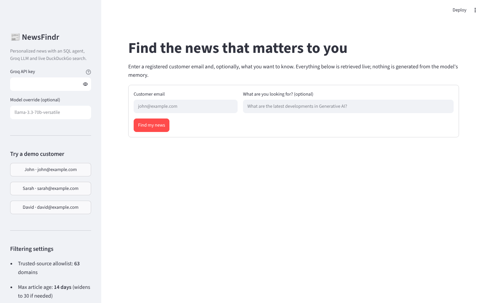
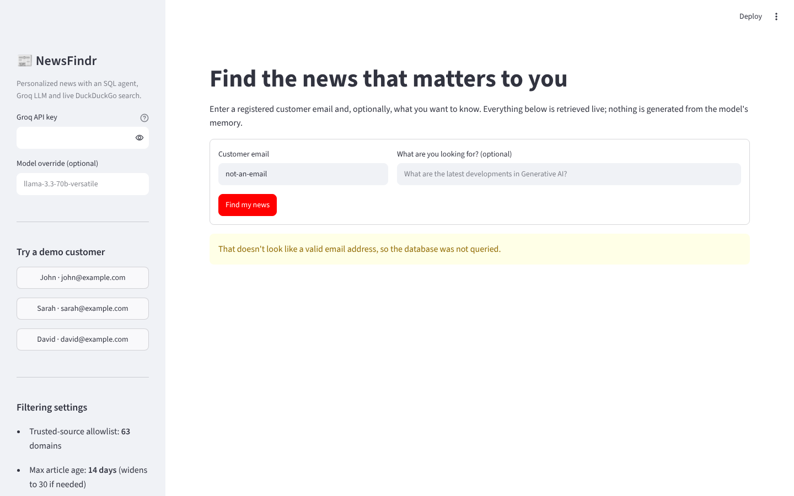

# NewsFindr: AI-Powered Personalized News Retrieval Agent

NewsFindr turns a customer's stored interests into a short, explainable, source-attributed news briefing.
A LangChain **SQL agent** (Groq LLM) verifies the customer, an LLM **expands** their interests into specific
queries, **DuckDuckGo News** supplies live articles, deterministic filters enforce recency, de-duplication and a
trusted-source allowlist, and the LLM **summarises only the retrieved text**. URLs, sources and dates always come
from the search results, never from the model.

```
User email → SQL Agent → Customer profile → Query expansion → DuckDuckGo News
          → Filtering & ranking → LLM review + summaries → Top-3 personalised articles
```

It ships in two forms that share the same logic:

| Form | File | Use it for |
|---|---|---|
| **Web app** (Streamlit) | `app.py` | Live end-to-end demos |
| **Notebook** (Google Colab) | `NewsFindr_Agentic_AI_News_Retrieval.ipynb` | Coursework, explanation, step-by-step outputs |

## Screenshots

**Landing page**: sidebar with the demo customers and filtering settings.


**Input validation**: a malformed email is rejected before the LLM or database is touched.


End-to-end result screenshots need a Groq key and live internet, so they are generated on your machine; see
[Capturing end-to-end screenshots](#capturing-end-to-end-screenshots).

## Run the web app

```bash
python -m venv .venv && source .venv/bin/activate
pip install -r requirements.txt
export GROQ_API_KEY=your_key_here      # free key: https://console.groq.com/keys
streamlit run app.py
```

Open <http://localhost:8501>, click a demo customer (John, Sarah or David) and press **Find my news**.
You can also paste the key into the sidebar instead of exporting it. It is never written to disk.

The app has four tabs:

* **Recommendations**: the top three articles, each with summary, "why this matches you", source, date and original link.
* **How it worked**: verified profile, expanded queries, filtering funnel, ranked candidates, LLM review, stage log.
* **SQL agent trace**: every tool call the SQL agent made on its own.
* **Filtered out**: each rejected article and the reason (duplicate, not on allowlist, outdated, low relevance).

### Customer database

The app uses `customer.db` (SQLite) in the working directory, or the path in `NEWSFINDR_DB`. If the file is missing it
is created with three sample customers; if it exists (for example your own database with an `email` and `interests`
column), the extra columns are added and the sample customers are inserted without touching existing rows.
`customer.db` is git-ignored.

## Run the notebook

1. Open `NewsFindr_Agentic_AI_News_Retrieval.ipynb` in Google Colab (**File → Upload notebook**).
2. Add a Colab Secret named `GROQ_API_KEY` (key icon in the sidebar) and enable notebook access.
3. Optional: upload your `customer.db` to `/content`.
4. **Runtime → Run all.**

Export for submission: **File → Download → .ipynb**, then `jupyter nbconvert --to html NewsFindr_Agentic_AI_News_Retrieval.ipynb`.

## Capturing end-to-end screenshots

```bash
pip install playwright && playwright install chromium
export GROQ_API_KEY=your_key_here
python scripts/capture_screenshots.py            # all screens, saved to docs/screenshots/
python scripts/capture_screenshots.py --only home,invalid_email   # no key or network needed
```

The script starts the app, runs the three demo scenarios (John → Generative AI, David → LLMs, Sarah → AI in
healthcare) and saves three images per scenario (recommendations, pipeline details, SQL agent trace). Results are
live, so they change on every run. Commit the images you like and embed them here, e.g.
``.

## Project layout

```
app.py                      Streamlit frontend
newsfindr/core.py           Pipeline: SQL agent, query expansion, search, filtering, summarisation
scripts/capture_screenshots.py   Playwright screenshot automation
docs/screenshots/           README images
NewsFindr_Agentic_AI_News_Retrieval.ipynb   Self-contained Colab notebook
requirements.txt
```

`newsfindr/core.py` was extracted from the notebook cells, and the notebook stays self-contained so it runs on its own
in Colab. If you change pipeline behaviour, update both.

## Design notes

* **What is autonomous:** only the SQL agent decides which tools to call. Query expansion, search, filtering and
  summarisation are a fixed, deterministic workflow with LLM-powered steps. This is a single-agent system, not multi-agent.
* **Privacy:** the database is opened read-only, the query tool accepts only a single `SELECT` filtered on the verified
  email and drops other customers' rows, and the agent's answer is cross-checked with a parameterized query.
* **Credibility:** the allowlist (`TRUSTED_SOURCES` in `newsfindr/core.py`) is a source-reputation prior. Being on it does
  **not** mean an article is fact-checked.
* **Grounding:** summaries use only the search-result title and snippet, are labelled as such, and any number not found
  in the source text is flagged.

## Future work

RAG over full article text, Qdrant for semantic relevance and de-duplication, LangGraph for a controlled multi-agent
graph, multi-source verification, feedback-driven recommendation learning, and scheduled monitoring.
